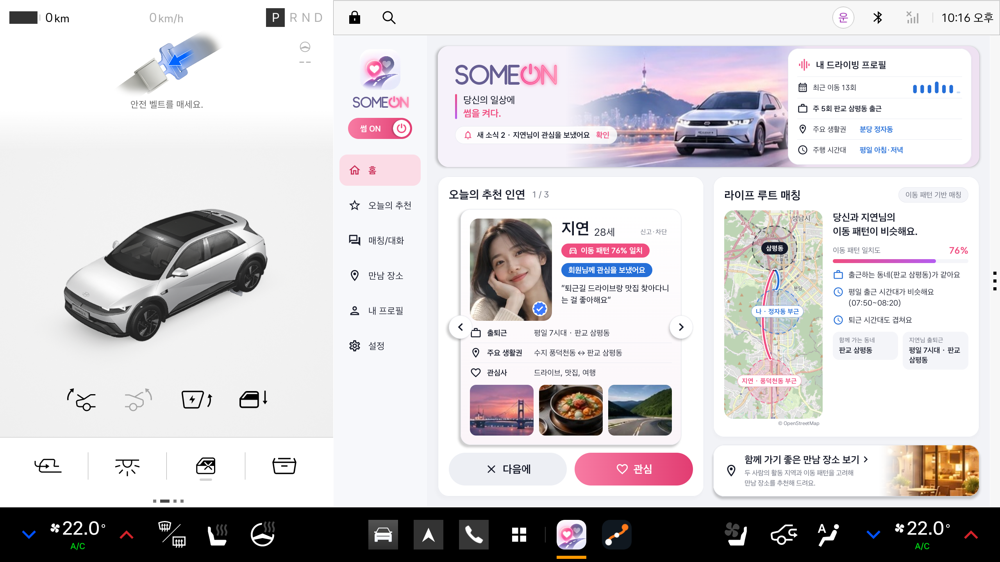
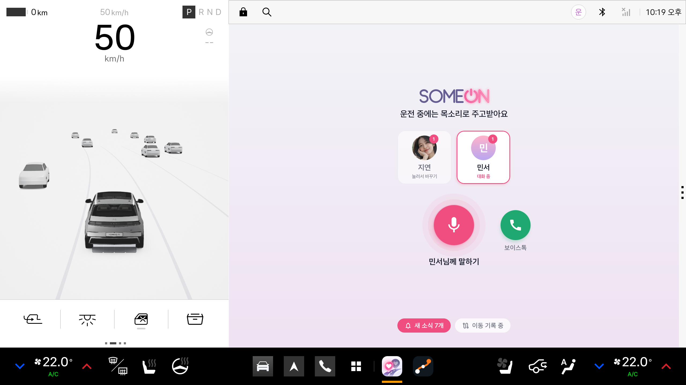
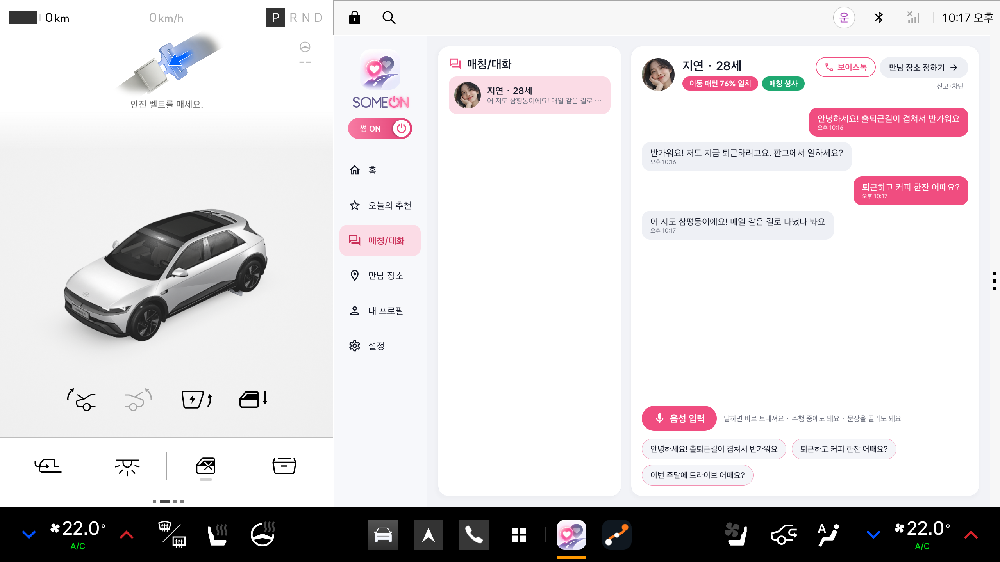
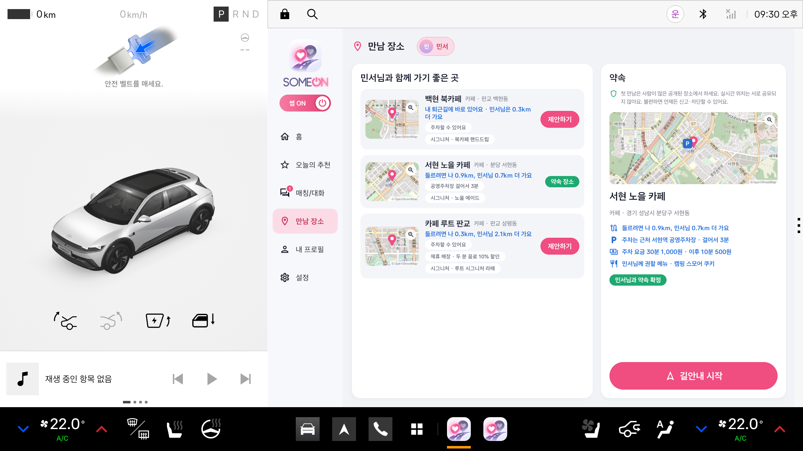

# SOMEON (썸온)

> 당신의 일상에 썸을 켜다.

**출퇴근길이 겹치는 사람을 차 안에서 이어 주는 Pleos Connect 차량용 소셜 매칭 앱** · 팀 온앤오프

운행 기록으로 자주 다니는 길과 시간대를 찾아 이동 패턴이 비슷한 사람을 추천합니다. 운전 중에는 목소리로만 메시지와 보이스톡을 주고받고, 차를 세우면 두 사람의 퇴근길 위에 있는 만남 장소를 골라 차 내비게이션으로 바로 안내합니다. 동승자가 타면 알림을 알아서 끄고 화면을 가립니다.

## APK

| 항목 | 내용 |
|---|---|
| 파일 | [`apk/온앤오프_SOMEON_release.apk`](apk/온앤오프_SOMEON_release.apk) |
| 빌드 | release (서명됨), 버전 1.0.0, 패키지 `com.drivemate.app` |
| 대상 | Pleos Connect (Android Automotive OS, Android 14 이상) |

## 실행 방법

### 1. 설치와 첫 실행

```bash
adb install apk/온앤오프_SOMEON_release.apk
adb shell am start -n com.drivemate.app/.MainActivity   # 또는 차 화면 아래 앱 목록의 SOMEON
```

1. 처음 실행과 권한 허용은 **P단 정차 상태**에서 해 주세요. 주행 중에는 안드로이드가 권한 창을 막습니다.
2. 홈의 "내 드라이빙 프로필" 카드에서 **동의하고 기록 시작** → 위치 권한 **앱 사용 중에만 허용**.
3. **설정 → 본인 인증**의 QR 코드를 휴대폰으로 찍어 인증합니다(공모전 시연용 모의 인증, 만 19세 이상 확인).
4. 같은 길을 같은 시간대에 세 번 이상 다니면 생활 패턴이 만들어지고 추천이 도착합니다.

### 2. 에뮬레이터에서 시연하기

에뮬레이터에는 일주일치 운전 기록도, 마이크도 없습니다. 그래서 adb로 보내는 시연용 명령을 release APK에도 넣었습니다. 이 명령은 `android.permission.DUMP` 권한이 있어야 받으므로 adb 셸에서만 보낼 수 있습니다.

```bash
# 일주일치 출퇴근 기록 넣기 (분당 정자동 → 판교 삼평동): "자주 다니는 길을 2개 찾았어요." 뒤 추천 3명
adb shell am broadcast -n com.drivemate.app/.DebugReceiver --es seed commute_week_A.csv

# 마이크 대신: 다음 음성 입력에 APK 안의 운전자 녹음을 넣기
#   minjun_message, minjun_answer, minjun_reply (메시지), minjun_call_1, minjun_call_2 (보이스톡)
adb shell am broadcast -n com.drivemate.app/.DebugReceiver --es hear minjun_message.pcm
adb shell am broadcast -n com.drivemate.app/.DebugReceiver --es talk minjun_call_1.pcm   # 보이스톡 중에 말하기

# 기어·속도·좌석 (Pleos Virtual Console: 브라우저로 http://127.0.0.1:8088 또는 이 스크립트)
adb forward tcp:8088 tcp:8088
python3 tools/vconsole.py drive 60               # D단 60km/h
python3 tools/vconsole.py park                   # P단 정차
python3 tools/vconsole.py seat passenger on      # 동승자 탑승 (off: 내림)
```

추천 시연 순서 (약 3분, 퇴근길 이야기):

1. P단에서 앱 실행 → 동의 → 일주일치 기록 넣기 → 설정에서 본인 인증. 추천 3명(지연·민서·하은)이 옵니다.
2. 약 45초 뒤 "지연님이 회원님께 관심을 보냈어요." → 지연 카드의 **관심** → "지연님과 썸이 켜졌어요." → **대화하기**.
3. D단으로 출발 → 주행 화면의 **음성 입력** → `hear minjun_message.pcm` → "보냈어요."
4. 8초쯤 뒤 차가 지연의 답장을 읽어 주면 `hear minjun_answer.pcm`, 다음 답장에는 `hear minjun_reply.pcm`("신기하네요 우리 통화할래요") → 지연이 보이스톡을 받습니다. 지연이 먼저 말하고, `talk minjun_call_1.pcm`, `talk minjun_call_2.pcm`으로 이어 갑니다.
5. P단으로 정차 → 대화창에 운전 중 나눈 대화와 통화에서 나온 "드라이브 브루 정자" → **만남 장소로 제안** → 지연이 수락 → **만남 장소 정하기** → **길안내 시작**.
6. `seat passenger on` → "동승자가 있어 알림을 잠시 꺼 둘게요." → 정차 화면이 가려지고 주행 중 소식은 개수만 → `seat passenger off`. 정차 화면의 **썸 스위치**를 끄면 다른 사람의 추천에서 잠시 빠집니다.

서버의 시연용 가상 사용자(지연·민서·하은·서윤·유나·준호)가 관심·답장·수락·보이스톡에 사람처럼 반응합니다(아래 [가상 사용자](#가상-사용자)). 화면별 설명은 [기능 안내](#기능-안내)에 있습니다.

### 3. 소스에서 빌드

```bash
export JAVA_HOME=<Android Studio 설치 경로>/jbr   # JDK 17 이상
./gradlew :app:assembleRelease    # app/build/outputs/apk/release/app-release.apk
./gradlew test                    # 단위 테스트 (core · server · app)
```

- Gradle 9.6, Android Gradle Plugin 9.4, Kotlin 2.2, compileSdk 37, minSdk 34.
- Pleos SDK(Vehicle, TextToSpeech, SpeechToText, NaviHelper)는 `settings.gradle.kts`에 적힌 Pleos Playground Maven 저장소에서 받습니다(계정 불필요).
- `local.properties`(git 제외)에는 `sdk.dir`만 있으면 됩니다. 선택 항목: `drivemate.serverUrl`(기본값 Render 서버), `drivemate.release.storeFile` · `storePassword` · `keyAlias` · `keyPassword`(release 서명 키, 없으면 디버그 키로 서명되어 그대로 설치·실행됩니다).
- 매칭 서버를 이 PC에서 띄우려면 `./gradlew :server:installDist && server/build/install/server/bin/server`(127.0.0.1:8080) 후 `./gradlew :app:installDebug -PserverUrl=http://10.0.2.2:8080`. 암호화하지 않은 http는 디버그 빌드에서만 허용됩니다.

## 테스트 환경 및 필요한 설정

| 항목 | 내용 |
|---|---|
| 에뮬레이터 | Android Studio의 Pleos Connect 에뮬레이터 v2.1.0 (AVD `Pleos_Connect_v2.1.0`, 시스템 이미지 `RELEASE.release_connect_v2.1.0`, x86_64) |
| 인터넷 | 매칭 서버 https://drive-mate-0ub6.onrender.com 에 연결합니다. 무료 서버라 한동안 쓰지 않으면 첫 응답에 최대 1분 걸립니다 |
| 권한 | 위치(앱 사용 중에만), 마이크, Pleos 차량 신호(주행 상태·좌석), 음성 합성(TTS), 음성 인식(STT), 내비게이션 경로 |
| 휴대폰 | 본인 인증 QR을 찍을 휴대폰(카메라) |
| 차량 신호 | Pleos Virtual Console(`adb forward tcp:8088 tcp:8088`)로 기어·속도·좌석을 바꿉니다 |

- HTTPS를 중간에서 검사하는 회사·기관망에서는 앱의 서버 연결과 에뮬레이터 내비("서비스 연결 중입니다")가 막힐 수 있습니다. 그때는 휴대폰 테더링 등 일반 인터넷에서 시연해 주세요.
- 에뮬레이터 내비의 지도 배경이 비어 있는 것은 에뮬레이터 지도 스타일 때문이며, 경로선과 회전 안내는 나옵니다.

## 기능 안내

| 정차 중 홈 | 주행 중 | 매칭/대화 | 만남 장소 |
|---|---|---|---|
|  |  |  |  |

### 한눈에 보는 흐름

| 단계 | 하는 일 | 어디서 |
|---|---|---|
| ① 이동 기록 | 운행(P단 출발 → 다음 정차)을 자동으로 기록하고 자주 다니는 길을 찾습니다 | 차 (자동) |
| ② 추천 | 출퇴근 시간대·동네가 비슷한 사람을 점수와 이유로 추천합니다 | 홈 · 오늘의 추천 |
| ③ 관심 · 매칭 | 서로 **관심**을 누르면 매칭되고 썸이 켜집니다 | 정차 중 |
| ④ 대화 | 음성 입력으로 말하면 메시지가 됩니다. 주행 중에 온 메시지는 읽어 줍니다 | 매칭/대화 · 주행 중 음성 |
| ⑤ 보이스톡 | 대화 중 통화를 요청하고, 상대가 받으면 핸즈프리로 통화합니다 | 매칭/대화 · 주행 중 음성 |
| ⑥ 만남 장소 | 두 사람의 퇴근길에서 가까운 공개 장소를 고르고 제안·수락합니다 | 만남 장소 |
| ⑦ 길안내 | 약속 장소를 차 내비게이션 목적지로 바로 보냅니다 | 만남 장소 → 내비 |

### 안전과 개인정보

- 운전 중에는 말로만 소통합니다. 주행 화면에서 누를 수 있는 것은 큰 **음성 입력** 버튼 하나(보이스톡 중에는 **끊기**)이고, 그 밖의 조작은 P단 정차 중에만 됩니다. P단이 1.5초 이상 유지되면 정차로 보고, 다른 기어가 되면 바로 주행 화면으로 바뀝니다.
- 정확한 위치는 차에만 저장합니다. 서버와 상대에게는 동네 이름과 시간대만 가고, 지도에는 반경 약 1.5km의 원만 보입니다(상대의 원은 서버가 실제 동네 중심에서 300~700m 비껴 보냅니다).
- 본인 인증(만 19세 이상)을 마친 사람만 관심·대화·만남 제안을 할 수 있습니다. 인증은 차에서 글자를 입력하지 않도록 휴대폰으로 QR을 찍어 합니다(공모전용 모의 인증, 실서비스는 통신사 본인확인).
- 동승자가 타면 "동승자가 있어 알림을 잠시 꺼 둘게요."라고 한 번 말하고 알림을 끕니다. 정차 화면의 추천·대화·만남 장소는 흐리게 가려지고(**지금 보기**로 열기), 주행 화면에는 이름과 얼굴이 나오지 않습니다.
- 정차 화면 왼쪽 로고 밑 **썸 스위치**를 끄면 다른 사람의 추천에서 빠지고 새 추천·관심 알림을 쉽니다. 매칭된 대화와 보이스톡은 그대로입니다.
- 추천 카드나 대화 화면의 **신고·차단**으로 상대를 즉시 차단할 수 있고, 설정의 **계정 삭제**는 차와 서버의 정보를 모두 지웁니다.

### 화면 구성 (정차 중 왼쪽 메뉴)

| 메뉴 | 내용 |
|---|---|
| 홈 | 새 소식 배너, 내 드라이빙 프로필(요일별 운행, 주 출근, 생활권, 주행 시간대), 오늘의 추천, 라이프 루트 매칭 |
| 오늘의 추천 | 추천 카드(사진, 일치도, 소개, 출퇴근·생활권·관심사)와 라이프 루트 매칭(지도 위 두 사람의 동네, 일치도, 추천 이유)을 크게 |
| 매칭/대화 | 매칭된 사람 목록과 대화, 음성 입력, 보이스톡, 만남 장소 정하기, 신고·차단 |
| 만남 장소 | 두 사람의 퇴근길 위 장소 3곳(각자 더 도는 거리, 주차·공영주차장, 메뉴), 제안·수락, 길안내 시작 |
| 내 프로필 | 상대에게 보이는 내 카드, 자주 가는 동네, 자주 다니는 길 |
| 설정 | 본인 인증, 썸 알림(음성 알림, 동승자가 타면 자동으로 끄기), 이동 기록 지우기, 계정 삭제 |

- **추천**: 같은 두 동네 사이를 비슷한 시각(45분 안쪽)에 서로 다른 날 세 번 이상 다니면 "자주 다니는 길"이 됩니다. 길마다 목적지 동네(45%)·출발 시간대(45%)·출발 동네(10%)를 비교하고 같은 요일 비율을 곱한 뒤, 주요 동네 두 곳이 겹치는지(20%)를 더해 50점 이상 중 상위 사람을 한 번에 3명까지 추천합니다. **다음에**를 누른 사람은 다시 나오지 않고 잠시 뒤(시연 1분) 새 사람이 옵니다.
- **대화**: 음성 입력으로 말하면 Pleos 음성인식이 받아 적어 보냅니다. 주행 중에는 버튼 위의 대화 상대에게 가고, "민서님, …"처럼 이름으로 시작하면 그 사람에게 갑니다. 답장에 "통화·전화·보이스톡"이 들어가면 보이스톡도 겁니다.
- **보이스톡**: 서로 전화번호를 모르고, 서버는 음성을 중계만 하며 녹음하지 않습니다. 30초 안에 받지 않으면 취소됩니다. 통화 중 만남 장소 후보 이름이 나오면 끝난 뒤 대화창에 "통화에서 ‘드라이브 브루 정자’ 얘기가 나왔어요"와 **만남 장소로 제안** 버튼이 남습니다(각 차가 자기 운전자의 말만 차 안에서 글자로 바꾸고, 서버에는 장소만 보냅니다).
- **만남 장소**: 둘 다 5km 안쪽으로 더 돌고 한쪽만 손해 보지 않는 곳 3곳을 고릅니다. 상대가 수락하면 "약속 확정", **길안내 시작**은 약속 장소(주차가 안 되면 근처 공영주차장)를 차 내비 목적지로 보냅니다. 장소 이름·혜택·메뉴·리뷰는 시연용 예시입니다.
- 차의 주간/야간 상태를 따라 밝은 화면과 어두운 화면으로 자동으로 바뀝니다.

### 운전 중에 들리는 음성

| 상황 | 음성 안내 |
|---|---|
| 새 추천 | 새 인연 추천이 도착했어요. 정차한 뒤 화면에서 확인하세요. |
| 상대의 관심 | 지연님이 회원님께 관심을 보냈어요. 정차한 뒤 화면에서 확인하세요. |
| 매칭 | 지연님과 썸이 켜졌어요. 정차한 뒤 화면에서 확인하세요. |
| 메시지 | 지연님 메시지예요. (내용) 답장하시려면 말씀해 주세요. → 말하면 답장이 가고 "보냈어요." |
| 음성 입력 | 지연님께 뭐라고 보낼까요? → 말하면 보내고 "보냈어요." |
| 보이스톡 | 지연님께 보이스톡을 걸었어요. → 지연님과 연결됐어요. → 보이스톡이 끝났어요. |
| 보이스톡이 왔을 때 | 지연님이 보이스톡을 요청했어요. 받으시겠어요? → "네"라고 하면 받습니다 |
| 약속 확정 | 지연님과 드라이브 브루 정자에서 만나기로 했어요. |
| 정차했을 때 | 정차했어요. 새 소식 2개를 화면에서 확인하세요. |

### 가상 사용자

차 한 대로도 전체 흐름을 볼 수 있도록 서버에 가상 사용자 6명이 있습니다. 메시지에는 8초 뒤 답하고, 만남 장소 제안은 8초 뒤 수락합니다.

| 이름 | 생활 패턴 | 반응 |
|---|---|---|
| 지연 (28) | 평일 7시대 수지 풍덕천동 → 판교 삼평동 | 잘 맞으면(80점 이상) 45초 뒤 먼저 관심, 보이스톡을 3초 뒤 받아 차례대로 이야기 |
| 민서 (31) | 평일 8시 40분대 분당 서현동 → 판교 백현동 | 관심을 받으면 20초 뒤 돌려줌(70점 이상) |
| 하은 (29) | 평일 9시대 분당 정자동 → 판교 운중동 | 관심을 돌려주지 않음(점수가 낮음) |
| 서윤 (27) | 평일 9시 20분대 분당 서현동 → 판교 백현동 | 처음 3명 중 한 명을 **다음에**로 넘기면 1분 뒤 추천 |
| 유나 (30) | 평일 10시대 분당 구미동 → 판교 운중동 | 한 명 더 넘기면 그다음으로 추천 |
| 준호 (33) | 평일 강남 역삼동 → 과천 | 방향이 달라 추천되지 않음 |

### 문제 해결

| 증상 | 확인할 것 |
|---|---|
| 추천이 오지 않아요 | 이동 기록 동의, 같은 길을 같은 시간대에 세 번 이상 다녔는지(내 프로필). 서버가 잠들어 있으면 첫 응답에 최대 1분 |
| "추천 서버에 연결하지 못했어요" | 인터넷 연결. 앱이 30초마다 다시 시도합니다 |
| 관심 버튼이 "인증하고 관심 보내기" | 설정에서 본인 인증 |
| 위치 권한 창이 안 떠요 | 주행 중에는 권한 창이 막힙니다. P단에서 다시 |
| 길안내 후 내비가 "서비스 연결 중" | 내비 앱의 인터넷 문제. 일반 인터넷(휴대폰 테더링 등)에서 다시 |
| 음성이 안 들려요 | 차량(에뮬레이터) 음량. 음성은 Pleos 기기 내 TTS |
| 음성 입력이 알아듣지 못해요 | 마이크 권한. 에뮬레이터는 마이크가 없으니 `--es hear` 녹음 사용 |
| 보이스톡이 연결되지 않아요 | 인터넷 연결. 상대가 30초 안에 받지 않으면 취소 |

## 개발에 사용한 Pleos Connect 에뮬레이터 버전과 화면 규격

| 항목 | 내용 |
|---|---|
| 에뮬레이터 | Pleos Connect v2.1.0 (`Pleos_Connect_v2.1.0`) |
| OS | Android 14 (API 34), Android Automotive OS |
| 화면 | 2560 × 1440 px, 160 dpi (mdpi), 가로 |
| 앱 영역 | 오른쪽 약 1705 × 1210 px (왼쪽은 Pleos 차량 정보, 아래는 공조·앱 독) |

## 저장소 구성

| 폴더 | 내용 |
|---|---|
| `app/` | 차량 앱 (Kotlin, Jetpack Compose, Pleos SDK) |
| `core/` | 이동 기록, 생활 패턴, 매칭 (순수 Kotlin, 앱과 서버가 함께 씀) |
| `server/` | 매칭 서버 (Ktor, Render 배포: `Dockerfile`, `render.yaml`) |
| `apk/` | 제출용 release APK |
| `tools/` | 출퇴근 시나리오, 시연용 녹음, Virtual Console 스크립트 |
| `docs/` | 기획([OVERVIEW](docs/OVERVIEW.md)), 개발 순서([ROADMAP](docs/ROADMAP.md)), [Pleos SDK 노트](docs/PLEOS_SDK_NOTES.md) |
| `submission/` | 앱 화면, 브랜드 |

개발 때 이름은 Drive Mate였고 코드·패키지(`com.drivemate.app`)·서버 주소에는 그 이름이 남아 있습니다.
